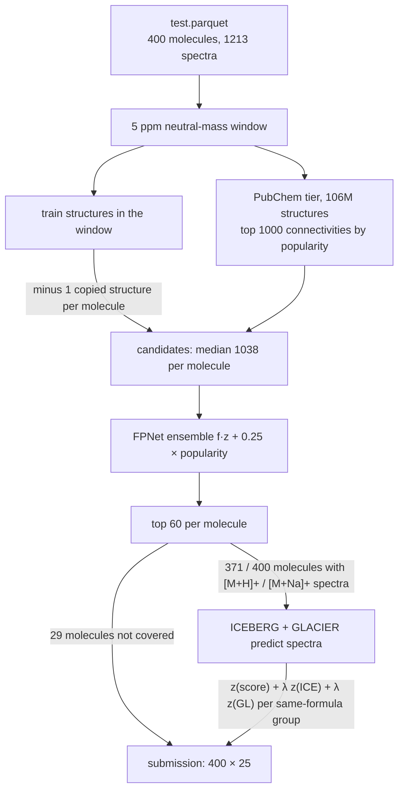

# casmi

Molecule identification from LC-MS/MS for the
[CASMI 2026 Kaggle competition](https://www.kaggle.com/competitions/enveda-CASMI26-molecule-id-mass-spectra):
up to 25 ranked SMILES per test molecule, scored by MRR@25 on the InChIKey connectivity block.
It is a code competition — a notebook, internet off — so every model and database is attached as a
Kaggle dataset.

**Best public score: 0.349** (v15, forward-model weights 1.0), against 0.421 for the public notebook its components come from and 0.48 at the top of the
leaderboard. The first submission scored 0.115 against a local estimate of 0.664; that estimate was
retracted, and since then only the leaderboard is trusted. The full history, one change per
submission, is in [PR #80](https://github.com/charleneleong-ai/ai4science/pull/80) and the
[spike writeup](docs/2026-10-07-casmi-spike.md).

## Pipeline



Everything runs in one self-contained notebook, [`notebooks/kaggle_submission.py`](notebooks/kaggle_submission.py):
[`PubChemTier`](notebooks/kaggle_submission.py#L292-L349) and [`candidates_for`](notebooks/kaggle_submission.py#L485-L501) build the
candidates, [`FPNetScorer`](notebooks/kaggle_submission.py#L380-L439) ranks them, and
[`ForwardRescorer`](notebooks/kaggle_submission.py#L537-L623) re-orders same-formula groups with the forward models. Its
module docstring keeps the score of every version. The attached datasets, image pin and T4 are in
[`notebooks/kernel-metadata.json`](notebooks/kernel-metadata.json).

[`src/casmi`](src/casmi) is the local package the notebook started from: a molecule-disjoint
[`split-eval`](src/casmi/cli.py) harness and the fragment-explainability ranker. Its numbers describe
train's own chemical space and do not transfer to the test set — see the
[harness docstring](src/casmi/harness.py).

## Running

```bash
uv run --extra dev pytest -q                                  # from casmi/
kaggle kernels push -p casmi/notebooks                        # from the repo root; runs on Kaggle
kaggle kernels output charyeezy/casmi-fragments-v1-nolookup -p <dir>
kaggle competitions submit enveda-CASMI26-molecule-id-mass-spectra -f submission.csv \
  -k charyeezy/casmi-fragments-v1-nolookup -v <version> -m "<one change>"
```

The notebook also runs locally against `train.parquet` and `test.parquet` in the working directory;
without the Kaggle datasets it falls back to fragment ranking over train, which reproduces the 0.115
submission byte for byte. [`tests/test_notebook_parity.py`](tests/test_notebook_parity.py) pins the
notebook's vendored logic against the package.

## Artefacts

| artefact | status |
|---|---|
| mermaid pipeline diagram | above, and in [PR #80](https://github.com/charleneleong-ai/ai4science/pull/80) |
| experiment card | [`docs/experiment-card.md`](docs/experiment-card.md) |
| LaTeX report | [`docs/report.pdf`](docs/report.pdf) ([source](docs/report.tex)) |
| W&B project, one run per submission | [report](https://wandb.ai/chaleong/casmi26/reports/CASMI-2026-—-molecule-identification-from-tandem-mass-spectra--VmlldzoxODA5MTIwOQ==) · [`casmi26` runs](https://wandb.ai/chaleong/casmi26) · rebuilt by `uv run --extra tracking casmi wandb-sync` from [`verdicts.yaml`](docs/experiments/casmi/verdicts.yaml) |
| published Claude Artifact | pending |

## What is not established

- **No local estimate of the competition score exists.** Train-derived labels were wrong, and
  consensus labels from public notebooks failed calibration (3 lineages, agreeing on 12 / 400 top-1
  picks). Each submission is the only measurement, at about five a day.
- **Identical runs differ by about ±0.005**, so smaller differences between versions are noise.
- **1189 / 1213 test spectra are bit-identical to a train row**, covering every molecule, yet the
  train structure attached is almost never the answer. Why the data looks like this is unexplained.
