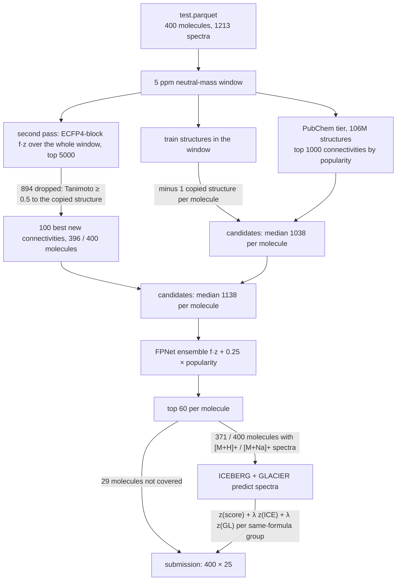

# casmi

Molecule identification from LC-MS/MS for the
[CASMI 2026 Kaggle competition](https://www.kaggle.com/competitions/enveda-CASMI26-molecule-id-mass-spectra):
up to 25 ranked SMILES per test molecule, scored by MRR@25 on the InChIKey connectivity block.
It is a code competition — a notebook, internet off — so every model and database is attached as a
Kaggle dataset.

**Best: 0.446** (e006 fork, 2026-10-17: the public E006 + PubChem promotion notebook run unchanged as our
private kernel [`casmi-e006-fork`](notebooks/fork446); it reproduces its public 0.446 exactly). Before it,
[`casmi-v4n-fork`](notebooks/fork421) scored 0.415 against its public 0.421, and our own pipeline's best is
0.356 (v19, 2026-10-12), so the public notebooks' library search over train plus learned ranker is worth
about +0.09 over everything we built. The top of the leaderboard is 0.495 (2026-10-17). The first submission scored 0.115 against a local estimate of 0.664; that estimate was
retracted, and since then only the leaderboard is trusted. The full history, one change per
submission, is in [PR #80](https://github.com/charleneleong-ai/ai4science/pull/80) and the
[spike writeup](docs/2026-10-07-casmi-spike.md).

## Pipeline



Everything runs in one self-contained notebook, [`notebooks/kaggle_submission.py`](notebooks/kaggle_submission.py):
[`PubChemTier`](notebooks/kaggle_submission.py#L292-L349) and [`candidates_for`](notebooks/kaggle_submission.py#L485-L501) build the
candidates, [`FPNetScorer`](notebooks/kaggle_submission.py#L380-L439) ranks them, and
[`ForwardRescorer`](notebooks/kaggle_submission.py#L537-L623) re-orders same-formula groups with the forward models. Its
module docstring keeps the score of every version. The attached datasets, image pin and T4 are in
[`notebooks/kernel-metadata.json`](notebooks/kernel-metadata.json).

[`src/casmi`](src/casmi) is the local package the notebook started from: a molecule-disjoint
[`split-eval`](src/casmi/cli.py) harness and the fragment-explainability ranker. Its numbers describe
train's own chemical space and do not transfer to the test set — see the
[harness docstring](src/casmi/harness.py). It also holds the LightGBM ranker study
([`ranker.py`](src/casmi/ranker.py), training set from the
[`ranker_trainset.py`](notebooks/ranker/ranker_trainset.py) kernel): on 1,881 held-out train molecules it
ties the hand-set score (MRR@25 0.296 vs 0.296), so it was not submitted — see the
[design and result](docs/specs/2026-10-11-casmi-ranker-design.md).
The [`recall_probe.py`](notebooks/recall/recall_probe.py) kernel and [`recall.py`](src/casmi/recall.py)
measure what a spectrum-driven second PubChem pass (as in the 0.421 notebook) adds to the popularity
shortlist on held-out train molecules. Scanning the whole window on the ECFP4 block and adding the 100
best of its top 5000 lifts recall from 126 to 236 / 280 and MRR@25 from 0.241 to 0.405 (+0.164, 95% CI
+0.124 to +0.209). Re-scoring the top 10,000 instead (probe v3, whole window kept) reaches 255 / 280, MRR@25
+0.020 over 5000 (95% CI +0.005 to +0.038); the whole window adds 3 more answers and no MRR. On the leaderboard the same pass (v18) scored 0.353, and with candidates similar to the copied
structure skipped ([`SecondPass.too_similar`](notebooks/kaggle_submission.py)) 0.356 (v19, the
pipeline now; its re-run 0.353). The copies exist only in the visible test, which is train examples;
the leaderboard scores a hidden test, so copy-targeted changes cannot move it. For 265 held-out
natural products (probe v4) the popularity shortlist already holds 215 / 247 answers, and the
second pass and COCONUT add at most one.

## Running

```bash
uv run --extra dev --extra ranker pytest -q                   # from casmi/
uv run --extra ranker casmi train-ranker                       # ranker CV on the kept training set
uv run casmi recall-probe                                      # second-pass recall / MRR@25 table
kaggle kernels push -p casmi/notebooks                        # from the repo root; runs on Kaggle
kaggle kernels output charyeezy/casmi-fragments-v1-nolookup -p <dir>
kaggle competitions submit enveda-CASMI26-molecule-id-mass-spectra -f submission.csv \
  -k charyeezy/casmi-fragments-v1-nolookup -v <version> -m "<one change>"
```

The notebook also runs locally against `train.parquet` and `test.parquet` in the working directory;
without the Kaggle datasets it falls back to fragment ranking over train, which reproduces the 0.115
submission byte for byte. [`tests/test_notebook_parity.py`](tests/test_notebook_parity.py) pins the
notebook's vendored logic against the package.

## Artefacts

| artefact | status |
|---|---|
| mermaid pipeline diagram | above, and in [PR #80](https://github.com/charleneleong-ai/ai4science/pull/80) |
| experiment card | [`docs/experiment-card.md`](docs/experiment-card.md) |
| LaTeX report | [`docs/report.pdf`](docs/report.pdf) ([source](docs/report.tex)) |
| W&B project, one run per submission | [report](https://wandb.ai/chaleong/casmi26/reports/CASMI-2026-—-molecule-identification-from-tandem-mass-spectra--VmlldzoxODA5MTIwOQ==) · [`casmi26` runs](https://wandb.ai/chaleong/casmi26) · rebuilt by `uv run --extra tracking casmi wandb-sync` from [`verdicts.yaml`](docs/experiments/casmi/verdicts.yaml) |
| published Claude Artifact | [CASMI 2026 Run Log](https://claude.ai/artifact/EYZSV6V6P6eHRp87TgSuJ9) (private; source [`docs/progress.html`](docs/progress.html)) |

## What is not established

- **No local estimate of the competition score exists.** Train-derived labels were wrong, and
  public notebooks cannot supply labels: their downloadable outputs score only ~12 smoke-test
  molecules and fill the rest with a placeholder (`CCO` / `CN`), because full predictions run only
  inside Kaggle's scoring rerun (`IS_RERUN` in the 0.421 notebook). The earlier "three lineages
  agreeing on 12 / 400" reading was those placeholders. Train cannot supply a test-like held-out set: 41 isomer pairs in 2.54M rows share a
  spectrum, 7 of them split across the fold-safe FPNet's training as the test's pairs are. Each submission is the only measurement, at about five a day.
- **Identical runs differ by about ±0.005**, so smaller differences between versions are noise.
- **1189 / 1213 test spectra are bit-identical to a train row**, covering every molecule, yet the
  train structure attached is almost never the answer. Why the data looks like this is unexplained.
