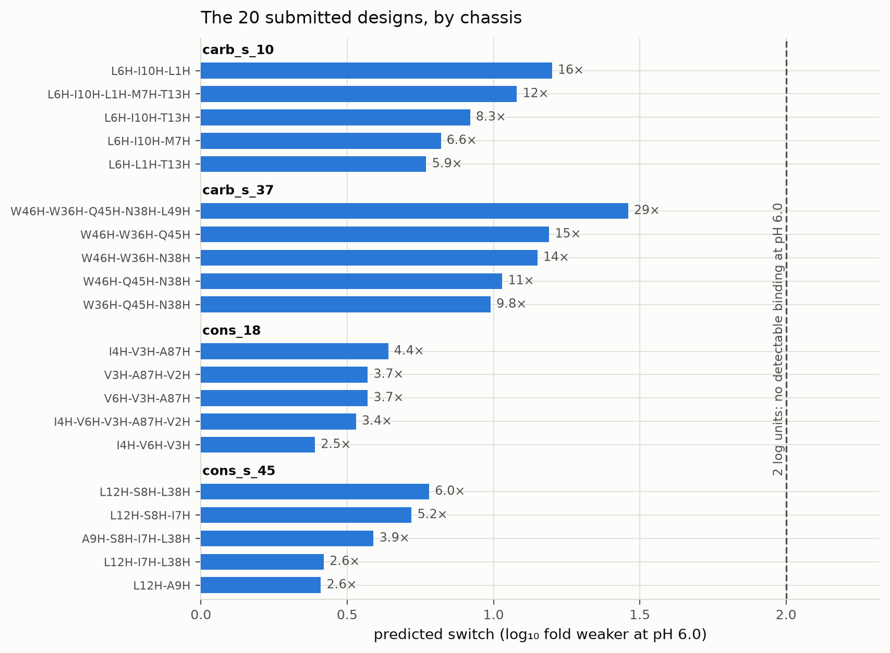
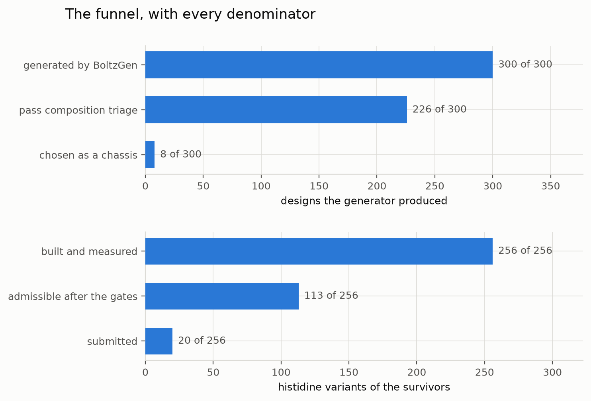

# tfr1 — a conditional TfR1 binder, with the epitope chosen by measurement

Adaptyv × Anthropic Protein Design Competition, challenge 04. Three objectives on one binder:
bind human TfR1, cross-react with mouse TfR1, and bind at pH 7.4 while releasing at pH 6.0.
Submissions close **Sunday 1 November 23:59 AoE** (Monday 2 November 22:59 Sydney).

**Status (2026-10-31): twenty designs selected, pending confirmation on independent poses.**
Nothing is measured in a wet lab and nothing is uploaded yet.

| stage | result |
| --- | --- |
| generated | 300 designs, 6 specs (3 epitopes × 2 length bands), 50 each |
| triage | **226 pass** (75%); best interface confidence ipTM **0.39** (46 res, short band) against 0.34–0.39 for the same pipeline on GLP1R |
| histidines present | **0 of 300** carry three; max is two — every switch has to be engineered |
| engineered | 8 chassis × histidine combinations = **256 variants**, each measured by two pKa methods |
| selected | **20 of 256**, 4 chassis, switch **0.39–1.46 log units** (2.5–29× weaker at pH 6.0) |
| 3DS18 chassis | strongest switch in the campaign (**1.44 / 1.57** log units) and **ineligible** — 100.0% identity to its own crystal `6wrv_C`, novelty 1 of 4 |

The 3DS18 work is kept as the **positive control that establishes the mechanism**, not as a
submission: `L33H` at 0.9 Å burial reads Δ −2.93/−3.17 while the native `His69` at 11.0 Å reads
−0.02 across all 32 variants.

## The headline: the recommended epitope serves the lowest-ranked objective

The organisers rank pH-selectivity first, mouse cross-reactivity second, affinity third — and
recommend the apical domain, then note in the next paragraph that mouse differs there at six of
nine residues. Measured here rather than taken on trust (see [`docs/target.md`](docs/target.md)):

| epitope | conserved human/mouse | carboxylates facing it | transferrin clearance |
| --- | --- | --- | --- |
| apical — **the recommendation** | **47%** (VP1u core 22%) | E350, E369 | 46.3 Å |
| 529 — conserved, clear | **90%** (only A529→I) | D525, E533 | 12.3 Å |
| 605 — carboxylate-rich | 83% | **4**: D604 E606 E664 D667 | 6.3 Å |
| 647 — helical | **100%** | D757, E759 | **0.0 Å — it *is* the transferrin site** |

**The most conserved surface on this receptor is the transferrin site.** Conservation and
function coincide, which is the real reason cross-reactive TfR1 binders are hard — the conserved
face is already spoken for. Three epitopes are carried rather than betting the entry on one
reading of the trade-off, and the funnel reports per-epitope survival so the choice is answerable
from data afterwards.

The scan's two binding gates (patch size ≥ 10, transferrin clearance ≥ 6 Å) were **loosened after
seeing the first result**, which is a post-hoc change and is declared as one in
[`docs/target.md`](docs/target.md) with the full sensitivity table — the size gate was landing on
the mode of the patch-size distribution and deciding the campaign by two residues.
`prepare_target.py` now refuses to cut a target whose centre the scan does not mark usable, after
an earlier revision hardcoded all three centres and shipped two that the gate had rejected.

## Calibrated against the organisers' own numbers before use

The scan reproduces two figures stated in the brief, from structure and sequence independently:

- the "nine residues" of the apical patch are exactly the VP1u contacts in **11RN** — 202, 204,
  208, 209, 210, 211, 212, 348, 371 — of which **two are conserved**;
- human/mouse identity over the ectodomain 121–760 comes out at **78.0%**.

Four of the brief's six named divergent residues land exactly; 210 and 211 differ only in where
the gap falls inside the 210–214 indel, which is alignment-ambiguous and leaves both
non-conserved either way.

## The pH switch is designed at the interface this time

The TNF-α campaign ranked its entry on six engineered histidines with pKa in the target window,
then measured the bound-vs-free linkage **Δ = pKa(complex) − pKa(free)** and found its two
best-determined positions **uncoupled on all 25 samples** — they titrate cleanly, and that does
nothing to binding, because an equilibrium identical in both states cancels. All six sat
**9–21 Å from the target, none in contact**.

So the constraint moved upstream: each epitope here was chosen partly for the receptor
carboxylates facing it, on the reasoning that those are what a designed histidine titrates
against *at the interface*. **That reasoning has since been measured, and it is wrong.** Across
114 readings on 44 TNF designs, Δ tracks how deeply binding buries the histidine — Spearman ρ
**+0.74** (PROPKA) and **+0.51** (pKAI) against distance to the target — and not proximity to a
carboxylate, where ρ was +0.12 and −0.27 with the two methods disagreeing on the sign. Buried
within 4 Å the median Δ is **−0.98**; further out, **−0.04**. Within 6 Å of an acid it is −0.225
against −0.200 further away, which is no difference. Reproduced independently on this target over
32 histidine variants of 3DS18, each on three crystallographically independent copies: Δ runs
−3.0 at 0.9 Å, −2.9 at 1.9 Å, −1.1 at 2.3 Å, −0.2 at 2.9 Å, and −0.02 for the native His69 at
11 Å in all 32 variants.

The mechanism is desolvation, not pairing. Burial penalises protonation in the complex but not in
the free binder, lowering the complex pKa and giving Δ < 0. A histidine beside a receptor
carboxylate is the opposite case — the acid stabilises the protonated form in the complex, raising
its pKa, so Δ > 0 and the binder holds on *harder* at pH 6.0. **The lever is burial on binding**,
and substitution positions are now chosen on buried area
([`his_variants.py`](scripts/his_variants.py), [`denovo_his.py`](scripts/denovo_his.py)). The
epitope named `carboxylate` keeps its name because the specs, design names and recorded results
are all written in terms of it; it is retained on its merits as the second-most conserved epitope
(83% human/mouse), not on its carboxylate count. The coupling verifier decides, not the pKa window
alone.

## Pipeline

| stage | what runs |
| --- | --- |
| target | [`target_sites.py`](scripts/target_sites.py) measures epitopes, conservation, exposure, glycan and transferrin clearance; [`prepare_target.py`](scripts/prepare_target.py) cuts each target and converts hotspots to the generator's 1-based chain positions, verified per residue |
| generate | BoltzGen, `protein-anything`, 50 designs × 3 epitopes × 2 length bands ([`specs/`](specs)) |
| triage | composition degeneracy, free cysteine, Glu-fraction expression predictor |
| switch | histidine scan at interface positions, then two pKa methods and the coupling check |
| confirm | Chai-1, which shares no weights with the generator |
| novelty | MMseqs2 and Foldseek on the design chain only |
| select | [`select_submission.py`](scripts/select_submission.py) applies the novelty and liability gates, then fills slots round-robin by chassis |
| report | [`plot_results.py`](scripts/plot_results.py) renders the burial finding, the chosen designs and the funnel from the measured tables |

## The twenty

Four chassis, five designs each, no two closer than two substitutions. Slots are filled
round-robin by chassis rather than greedily by switch, because a chassis the novelty gate rejects
scores nothing whatever its switch is. Two chassis carrying an unpaired cysteine are dropped by
default, which costs nothing on the first-ranked objective — median switch **0.78 log units**
either way — and
[`submission_candidates_with_cys.csv`](results/submission_candidates_with_cys.csv) holds the
alternative that keeps them.

Novelty is a gate, not an objective, and it eliminated more than the switch did:
`conserved_s_16` (fold TM 0.94 over 100% coverage) and `conserved_20` (0.90 over 95%) both score
a predicted 2 and are excluded; `conserved_s_44` is the only predicted *de novo* 4.

## What is not established

Nothing is measured. The conserved patch at 529 has **no precedent as an epitope** — no structure
shows anything bound there, so unlike the apical site there is no evidence it is druggable, only
that it is conserved, exposed, and clear of both glycans and the transferrin site. The cut targets
expose faces that are interior in the intact ectodomain. Binding is measured on the homodimer, so
avidity may flatter a weak monovalent design. Mouse cross-reactivity is predicted from a sequence
alignment, not a mouse structure.

The switch on the de novo designs is measured on **one pose per design**, so the replication axis
is the two pKa methods rather than independent structures — a position counts only when PROPKA
and pKAI agree, and contributes the smaller of the two estimates, but neither method is a
measurement of Kd. The novelty scores are a **conservative local proxy** for Proteinbase's own
scorer, not its output: the fold half measures more similarity than theirs does, so a `high`
verdict reliably predicts rejection while a `moderate` one may still pass.
