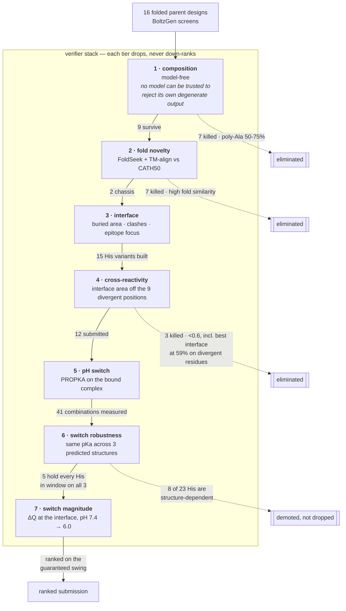

# Conditional TNF-α binder — methodology

## This is a designed series, not 12 independent guesses

The set is built to be **informative whichever way it reads in the lab**. Ten designs are a
histidine titration on one backbone spanning predicted pKa 6.07–7.12, with one, two or three
histidines; two more are a **matched pair on a second backbone — `tnf2_01` carries the switch,
`tnf2_12` is the identical sequence with zero histidines.** That pair is the control: if
`tnf2_01` shows pH-dependent release and `tnf2_12` does not, the switch is the cause, and if
neither does, pKa-engineered switching is ruled out on this scaffold rather than left ambiguous.

## Epitope: computed, not taken from literature

TNF-α residues within 4.5 Å of TNFR2 in **3ALQ**, intersected with a human/mouse alignment of
the soluble domain (124/157 = **79.0 %** identity), give **33 contact positions: 24 conserved,
9 divergent** (P20H, R31Q, S71D, T72–, H73Y, V85I, T89E, I97V, A111L).

**R31→Q is the trap.** It carries the largest solvent-accessible area in the epitope (193 Ų)
and sits beside R32 in the 29–33 loop that adalimumab and infliximab both engage — which is
why neither is mouse cross-reactive. Those nine positions were set as coldspots and the
conserved patches targeted instead, so cross-reactivity is designed in rather than hoped for.

## pH switch: scanned, then measured in combination

PROPKA 3.5.1 over PyRosetta-built side chains, on the **bound complex**, not the free binder.
Every interface position was substituted to histidine in turn (23 on the lead chassis), giving
6 switchable sites, 4 of them in the ideal 6.3–7.2 window.

**Combinations were measured, never composed from single-mutant values.** This mattered:
`A35H+A38H` drops A35 from 6.07 to **5.94, out of the window**, and `A70H+A72H` drops A70 from
6.44 to 6.23. All 41 combinations of the six sites were scanned.

**And every surviving pKa was then re-measured against three independent predicted structures**
rather than the one it was designed on. This is the check we would most want someone else to
have run on us: 8 of 23 histidines do not hold their window across all three, and `R21H` alone
ranges 3.99–6.70 where its design structure read 7.05. Five designs hold every histidine in
window on every structure; they lead the ranking, and the single most reproducible switch is
`R72H` at 6.37 with a spread of 0.27.

Three mechanisms we initially reasoned toward were each refuted by the scan: burying the
histidine *lowers* its pKa (r = −0.37), a neighbouring cation has the wrong sign (r = +0.11),
and carboxylate proximity gives only r = +0.21 with counter-examples at net +6 sitting at
pKa 3.6. The positions here are empirical, from an exhaustive scan plus a physics solver.

## The verifier stack

Each tier judges something the tier above cannot see, and tiers **drop** candidates rather than
down-rank them. Counts are for this round: 16 folded parent designs in, 12 submitted.

**Tier 6 is the one that changed the answer.** Every pKa originally came from a single predicted
structure. Re-scoring each histidine against all three Boltz diffusion samples showed **8 of 23
are structure-dependent** — including the design this submission originally led with, whose
switch reads 6.27 on one structure and 5.92 averaged over three. The ranking below is the
corrected one; nothing was dropped on this basis, because a structure-dependent prediction is
weak evidence rather than evidence of failure.

## Selection

Designs passed independent gates before ranking, and the gates **dropped** candidates rather
than down-ranking them — the top-scoring construct of an earlier round was verbatim ubiquitin,
and the top of a 40-design shortlist was 59 % alanine.

- **composition** — model-free; rejects low-complexity and poly-alanine output
- **fold novelty** — FoldSeek + TM-align against CATH50
- **interface** — buried surface area and steric clashes, not contact counts
- **cross-reactivity** — fraction of buried interface area *off* the 9 divergent positions

### Ranking: the swing, not the count

Counting "histidines in the window" treats a pKa of 6.0 and 6.7 as equal when they are not, so
the ranking uses the quantity the assay actually reads: **ΔQ, the charge the interface gains
going from pH 7.4 to pH 6.0**, by Henderson–Hasselbalch on each measured pKa. It peaks at
pKa 6.7, the midpoint of the two assay points — so distance from 6.7, not a low pKa as such, is
what costs a design.

Each design is ranked on its **ΔQ floor**: every histidine scored on whichever of its three
structures gives the smaller swing. That is a lower bound on the switch, not a best case.

| | ΔQ floor | robust His |
| --- | --- | --- |
| `tnf2_01` (3 His) | **1.38** | 3/3 |
| `tnf2_04`, `tnf2_05` (2 His) | 0.89–0.99 | 2/2 |
| `tnf2_09` (1 His) | 0.57 | 1/1 — most reproducible single, spread 0.27 |
| `tnf2_12` (1 His) | **0.01** | 0/1 — the switch vanishes on its worst structure |

One ideally-placed histidine can contribute at most ~0.62, so the three-histidine lead design
is carrying roughly 2.2 histidines' worth of guaranteed swing.

`tnf2_06` is ranked above its ΔQ (0.37) deliberately: it is the only design with a credible
measured interface (923 Ų buried, zero cysteines, novelty 4/4), and **a design that does not
bind cannot show pH-dependent release at all**. `tnf2_07` follows it as its matched control.

Cross-reactivity, not affinity, did the discriminating: it ranged 0.41–0.89 across variants. One
design with the family's best interface confidence put **59 % of that interface on
human/mouse-divergent residues** and was dropped, along with two others below 0.60.

A measured trade-off worth stating: **each added histidine costs interface confidence** — mean
binder-to-target ipTM 0.235 for singles, 0.180 for doubles, 0.158 for triples. The series spans
that trade-off deliberately rather than picking one point on it.

## What is not established

**No measured binding of any kind.** No expression, SEC, thermal stability, SPR or BLI; every
number above is computational. pH selectivity rests on predicted pKa, and no folding model
represents protonation state — the robustness tier above bounds how much that prediction moves
with the input structure, which is not the same as showing it is right. Mouse cross-reactivity rests on a predicted mouse structure and
conserved-epitope coverage, not on measured binding to mouse TNF-α.

Interface confidence is **model-dependent and unresolved**, so a range is reported rather than a
number: AlphaFold2 rated its own optimised designs at i_pTM 0.92 where Boltz-2 rated the same
structures 0.21. No design here was scored by a model that also optimised it. Global ipTM is not
used at all — on a homotrimer target it is inflated by +0.405 on average by the target's own
internal interfaces; all values are binder-to-target chain-pair ipTM, symmetrised and averaged
across diffusion samples rather than taken best-of-n.

One earlier design failed your novelty check at 37.5 % sequence identity while two passed at
38.1 %: the failure was **fold**, not sequence — an immunoglobulin-like β-sandwich at TM 0.893.
That rule shaped this round's selection.
